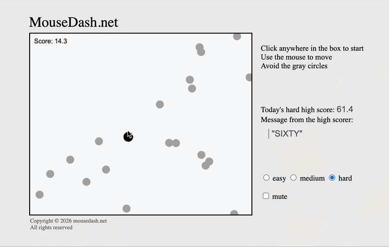

# MouseDash

A browser reflex game with a global daily leaderboard. Dodge the circles, survive as long as you can, and leave a message if you take the top spot. 

125,000+ games played in the first two weeks.

**Play it: [mousedash.net](https://mousedash.net)**

---

## Stack

- **Phaser 3** for rendering and input
- **Vanilla JS, HTML, CSS** - no framework, hand-written styles
- **Firebase Cloud Functions** (Node) for score validation
- **Firebase Realtime Database** for the leaderboard
- **Firebase App Check** (reCAPTCHA v3) for request attestation
- **Cloudflare Workers** for hosting, with an esbuild step on deploy

---

## Anti-cheat

The core problem: the game runs in the player's browser, and is thus under the player's control. Scores can't be trusted on arrival.

The approach is to make the server the authority on everything it can measure:

- **Session tokens.** Single-use token issued on game start. A score submitted without a valid, unused token is rejected.
- **Elapsed-time validation.** Score equals seconds survived, so the server can check the claimed score against time measured since game start. Claiming 300 seconds requires 300 seconds to have actually passed.
- **Attestation.** App Check verifies requests originate from the real site rather than a script.
- **Score history.** Every record-beating score is retained, so a bad entry can be removed and the previous legitimate leader is restored automatically.

---

## Known limitations

A player can still cheat by modifying the client to make the game easier and then beating the high score. Closing that would require deterministic replay validation (seeded RNG, fixed timestep, and re-simulating the input log server-side), which is out of scope for a project of this size. The current design bounds what a cheater can claim and makes removal cheap, rather than making cheating impossible.

Anonymous auth means bans are easily evaded. Moderation of the high score message is a banned word list, which is inherently incomplete.
